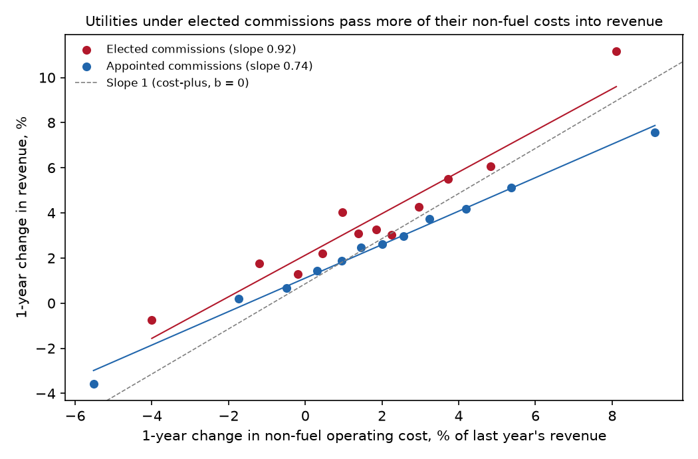
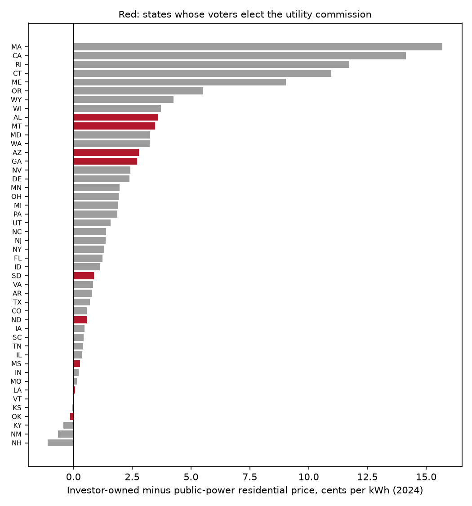

# The Bill Follows the Cost

### In 1991, Jean-Jacques Laffont and Jean Tirole showed that a regulator who might be captured should give the firm it oversees weak incentives to cut costs. I measured how weak those incentives are for American electric utilities, and whether they are weaker where utility commissioners run for office.

---

In 2024 Georgia Power's 2.45 million residential customers paid an average of 15.49 cents for each kilowatt-hour
they used. The municipal systems and cooperatives that serve the rest of Georgia charged their households 12.78
cents. Georgia Power answers to the Georgia Public Service Commission, five commissioners chosen by the state's
voters in partisan elections, and in a year like 2022 the commission's arithmetic is easy to see in the company's
federal filings. Georgia Power's electric revenue rose by $2.33 billion that year, from $9.11 billion to $11.44
billion. Its bill for fuel and purchased power rose by $1.81 billion. Most of what customers paid extra was what
the company paid extra, passed along.

That is how most American utility regulation works. A commission adds up what the company spends, adds a return
on the money its shareholders have invested in plants and wires, and sets rates to cover the total. When costs
rise, the bill follows. When the company finds a saving, customers get most of it at the next rate case. Economists
call an arrangement like this low-powered, because the company keeps little of any dollar it saves and pays little of
any dollar it wastes. The usual economic case against it is that a stronger incentive would make the company cut
costs. Laffont and Tirole argued that weak incentives might be the price of a regulator who can be bought.

---

## How much of a cost overrun the firm pays

The measure that matters here is the power of a regulatory scheme, which Laffont and Tirole wrote as $`b`$. Think
of the regulator as reimbursing the firm's cost $`C`$ and paying it a fixed amount $`a`$ on top, minus a share
$`b`$ of the cost. The firm's revenue $`R`$ is then

```math
R = C + (a - bC) = a + (1 - b)\,C
```

so $`1 - b`$ is the share of each dollar of cost that ends up in revenue, which I will call the pass-through, and
$`b`$ is the share the firm's owners absorb. Three cases mark out the range.

| Scheme | Power $`b`$ | Pass-through $`1-b`$ | What happens when costs rise $1 |
|---|---|---|---|
| Fixed price (a price cap) | 1 | 0 | Shareholders pay the whole dollar |
| A typical incentive plan with 50/50 sharing | 0.5 | 0.5 | Half goes on the bill |
| Cost-plus | 0 | 1 | Customers pay the whole dollar |

Real filings let me estimate $`1 - b`$ from changes in revenue and cost. For Georgia Power between 2021 and 2022,
using $`F`$ for fuel and purchased power and $`N`$ for every other operating cost except income taxes, in billions
of dollars:

```math
\frac{\Delta R}{\Delta F + \Delta N} = \frac{11.440 - 9.107}{(4.771 - 2.964) + (3.715 - 3.518)} = \frac{2.332}{1.807 + 0.196} = 1.16
```

A ratio above one in a single year is not a contradiction. Georgia Power's net electric plant also grew by $1.73
billion that year, and a regulated utility earns a return on new plant, so part of the revenue increase pays for
capital rather than for operating cost. The regressions below separate the three, across two decades of filings
from more than a hundred utilities.

---

## Jean-Jacques Laffont, Jean Tirole and the regulator in the middle

Jean-Jacques Laffont was born in Toulouse in 1947, took his doctorate at Harvard in 1975, and spent most of his
career building the economics department at the University of Toulouse into one of the best in Europe. At the
start of the 1990s he founded its Institut d'Economie Industrielle. Jean Tirole, six years younger, was at MIT when the two began
working together in the 1980s, and later joined Laffont in Toulouse. Their 1993 book on procurement and regulation
became the field's standard reference. Laffont died in 2004, at 57. Ten years later Tirole received the Nobel
Prize in economics for his analysis of market power and regulation, and said in his prize interview that Laffont
probably deserved to share it.

"The Politics of Government Decision-Making: A Theory of Regulatory Capture" appeared in the *Quarterly Journal of
Economics* in November 1991. It took George Stigler's old idea, that regulated industries end up running their
regulators, and asked what a legislature that understood the danger would do about it. Laffont and Tirole built a
chain of three. Congress, at the top, wants to maximize the public's welfare but knows little about the firm. The
agency, in the middle, can investigate and sometimes learns the firm's true costs. The firm, at the bottom, knows
its costs and chooses how hard to work at lowering them. The firm can reward the agency for burying what it
learns, through favors, money, or the promise of a later job.

In a stripped-down version of the model, with my notation, a firm is either efficient, with cost parameter
$`\underline{\beta}`$, or inefficient, with $`\bar\beta = \underline{\beta} + \Delta\beta`$, and the efficient kind occurs with
probability $`\nu`$. Cost is $`C = (\beta - e)q`$, where $`q`$ is output, held fixed, $`e`$ is effort and
$`\psi(e)`$ its rising, convex disutility. Raising a dollar of public money costs society $`1 + \lambda`$, so each
dollar of rent left with the firm costs society $`\lambda`$. If the efficient firm pretends to be
inefficient it needs $`\Delta\beta`$ less effort, which earns it the rent $`\Phi(e) = \psi(e) - \psi(e - \Delta\beta)`$,
where $`e`$ is the effort asked of the inefficient firm. That rent is what the firm would pay the agency to keep
quiet. The agency learns the truth with probability $`p`$, and a dollar of bribe costs the firm
$`1 + \lambda_f`$. When the agency reports what it learned, Congress imposes the full-information contract, so
the effort $`e`$ matters only when the agency has nothing to report. Let $`W^{FI}(e)`$ be expected welfare from the
inefficient firm at effort $`e`$ with no rent paid, whose slope is $`(1-\nu)(1+\lambda)(q - \psi'(e))`$. Congress
pays the agency $`\Phi(e)/(1+\lambda_f)`$ for reporting, just enough to outbid the firm, and chooses $`e`$ to
maximize the part of expected welfare that depends on it.

```math
\begin{aligned}
\max_{e}\;& (1-p)\big[W^{FI}(e) - \lambda\nu\,\Phi(e)\big] - p\,\nu\,\lambda\,\frac{\Phi(e)}{1+\lambda_f} \\
\text{FOC:}\;& (1-p)(1-\nu)(1+\lambda)\big(q - \psi'(e)\big) \\
&\quad = \lambda\nu\,\Phi'(e)\Big[(1-p) + \frac{p}{1+\lambda_f}\Big] \\
\Rightarrow\;& \psi'(e) = q - \kappa\,\Phi'(e), \\
&\quad \kappa \equiv \frac{\lambda}{1+\lambda}\,\frac{\nu}{1-\nu}\Big[1 + \frac{p}{(1-p)(1+\lambda_f)}\Big] \\
\Rightarrow\;& b = \frac{\psi'(e)}{q} = 1 - \kappa\,\frac{\Phi'(e)}{q}
\end{aligned}
```

The last line uses the fact that a firm offered $`t = a - bC`$ works until the marginal disutility of effort equals
$`bq`$. The constant $`\kappa`$ measures the distortion. When bribes are impossibly expensive,
$`\lambda_f \to \infty`$, the bracket inside $`\kappa`$ equals one and the formula collapses to the standard rule
from Laffont and Tirole's 1986 paper. When bribes are cheaper, the bracket grows, and, for a given slope of the
rent, the power of the scheme falls. Congress deliberately weakens the inefficient firm's incentive, because a
weaker incentive shrinks the efficient firm's rent, and a smaller rent is a smaller prize for capturing the
regulator. The paper's abstract puts it in one clause, that "the threat of producer protection leads to
low-powered incentive schemes." It also says the efficient firm ends up with less rent than it would get without
the threat, which is the opposite of what a simple capture story predicts.

The strongest objection came from a different kind of political economy. Timothy Besley and Stephen Coate, in
"Elected versus Appointed Regulators: Theory and Evidence" (*Journal of the European Economic Association*, 2003),
argued that when voters elect their regulators directly, regulation becomes a campaign issue of its own and
candidates compete to be the consumer's friend. The 2000 working-paper version reported evidence from a panel of
American states that states electing their commissioners were "more pro-consumer in their regulatory policies."
On their account an elected commission
is harder to capture, not easier. Laffont and Tirole's theory says the institution responds to the risk of
capture. It does not say on its own which institutions carry more of that risk, and that is the question the
data can help with.

---

## How I tested it

The theory is about the shape of the contract, so the test measures the contract. Every investor-owned electric
utility files FERC Form 1 with the Federal Energy Regulatory Commission each year, and the Catalyst Cooperative's
PUDL project publishes the filings as clean tables. I took electric operating revenue, fuel and purchased power,
all other operating and maintenance cost, depreciation, amortization and taxes other than income taxes, and net
electric plant for every respondent from 2005 to 2025. I matched each company to the states where it has retail
customers using the Energy Information Administration's Form EIA-861 for 2024, which kept 123 utilities that still
sell to homes and businesses. I dropped utility-years with electric revenue under $50 million, changes in revenue
of more than half in a year (mergers and spin-offs), and the top and bottom 1% of each cost change. That leaves
1,998 one-year changes from 115 utilities in 48 states, and 1,782 three-year changes.

For utility $`i`$ in year $`t`$, with $`k`$ equal to one or three years, I estimate by least squares

```math
\begin{aligned}
\frac{\Delta_k R_{it}}{R_{i,t-k}} = \mu_t &+ \gamma_F \frac{\Delta_k F_{it}}{R_{i,t-k}} + \gamma_N \frac{\Delta_k N_{it}}{R_{i,t-k}} + \gamma_K \frac{\Delta_k K_{it}}{R_{i,t-k}} \\
&+ \delta_F E_{it}\frac{\Delta_k F_{it}}{R_{i,t-k}} + \delta_N E_{it}\frac{\Delta_k N_{it}}{R_{i,t-k}} + \theta E_{it} + \varepsilon_{it}
\end{aligned}
```

where $`\mu_t`$ is a year effect, $`K`$ is net electric plant, and $`E_{it}`$ is the share of the utility's
retail customers in states whose voters elect the utility commission. Those are Alabama, Arizona, Georgia,
Louisiana, Mississippi, Montana, Nebraska, North Dakota, Oklahoma and South Dakota, plus New Mexico through 2022,
when its commission was elected. The estimated powers are $`\hat b_F = 1 - \hat\gamma_F`$ and
$`\hat b_N = 1 - \hat\gamma_N`$. The null hypothesis is $`H_0: \delta_N = 0`$. If elected commissions are the
easier channel for the firm's money, which is what the Arizona disclosure described below suggests, Laffont and
Tirole predict $`\delta_N > 0`$. If Besley and Coate are right that elected commissions are harder to capture, the
sign should be negative or zero. Standard errors are clustered by the utility's main state, because commission type
is a state attribute, and I also report them clustered by utility.

Non-fuel cost is the interesting term. Nearly every state lets utilities pass fuel and purchased power through to
customers automatically, so $`b_F`$ should be close to zero everywhere. Wages, tree-trimming, storm repair and
overhead go through rate cases, and that is where a commission decides how much of the risk the company carries.

---

## American utilities bear about a fifth of their non-fuel costs

The pooled estimates, with all 115 utilities, show regulation close to cost-plus.

| Cost | Pass-through, 1-year changes | Implied power $`b`$ | Pass-through, 3-year changes | Implied power $`b`$ |
|---|---|---|---|---|
| Fuel and purchased power | 0.916 (0.029) | 0.08 | 0.975 (0.022) | 0.03 |
| All other operating cost | 0.765 (0.036) | 0.24 | 0.818 (0.040) | 0.18 |

*Standard errors clustered by state in parentheses. 1,998 one-year and 1,782 three-year changes.*

```math
\hat b_N^{\,1\text{-yr}} = 1 - 0.765 = 0.235\;(0.036),\qquad \hat b_N^{\,3\text{-yr}} = 1 - 0.818 = 0.182\;(0.040)
```

Of every extra dollar a utility spends on fuel or wholesale power, about 92 cents shows up in revenue the same year
and about 97 cents within three years. Of every extra dollar of other operating cost, about 77 cents shows up within
a year and 82 cents within three. Shareholders carry roughly a fifth of the risk on the costs a utility actually
controls, and almost none on fuel. Laffont and Tirole's theory says there should be distortion of this kind, and
that capture risk makes it worse. The data show the level. They cannot say how much of it comes from capture rather
than from the ordinary information problem, since the same direction is predicted either way.

---

## Utilities under elected commissions pass through more

Splitting the sample by commission type, the difference runs in the direction Laffont and Tirole predict if elected
commissions are the easier ones to reach.

| Utilities with most customers in | Utilities | Changes | Non-fuel pass-through, 1-year | Power $`b_N`$ | Non-fuel pass-through, 3-year | Power $`b_N`$ |
|---|---|---|---|---|---|---|
| States with elected commissions | 19 | 313 | 0.921 (0.074) | 0.08 | 1.019 (0.065) | −0.02 |
| States with appointed commissions | 97 | 1,685 | 0.742 (0.037) | 0.26 | 0.801 (0.043) | 0.20 |

```math
\hat\delta_N^{\,1\text{-yr}} = 0.166\;(0.078),\quad 95\%\ \text{CI}\ [0.013,\ 0.318],\quad p = 0.033,\quad N = 1{,}998
```

At utilities such as Georgia Power, Alabama Power, Arizona Public Service and Oklahoma Gas and Electric, a dollar
of non-fuel cost reaches revenue almost in full within a year, and over three years the estimate is
indistinguishable from complete pass-through. Under appointed commissions, a quarter of the dollar stays with
shareholders in the first year and a fifth after three. Clustering by utility instead of by state leaves the
one-year interaction significant ($`p = 0.047`$). It is weaker everywhere else. Over three-year changes the
interaction is 0.126 (0.086), $`p = 0.15`$, and restricted to the 78 utilities that burn fuel in their own power
plants it is 0.120 (0.083), $`p = 0.14`$. The point estimate stays between 0.12 and 0.17 in every version, but only
19 utilities in 10 states sit on the elected side, and the evidence is suggestive rather than settled.



The other half of the prediction concerns rents. A Stigler-style captured commission should let its utility earn
more. Laffont and Tirole predict that the response to capture squeezes the efficient firm's rent instead. Over
2015 to 2025, operating income before income taxes as a share of the previous year's net electric plant averaged
7.08% for utilities under elected commissions and 7.32% under appointed ones. Regressing the return $`r_{it}`$, in
percentage points, on the elected share with year effects $`\mu_t`$, standard errors clustered by state, gives

```math
\begin{aligned}
r_{it} &= \mu_t + \theta_r E_{it} + u_{it} \\
\hat\theta_r &= -0.32\;(0.40),\quad p = 0.43,\quad N = 1{,}170
\end{aligned}
```

Utilities in elected states do not earn more on their plant, which is what Laffont and Tirole's account allows and
what the simple capture story rules out.

| Utility | Main state | Commission | 2024 electric revenue | Own non-fuel pass-through, 3-year changes | Pre-tax return on plant, 2015–25 |
|---|---|---|---|---|---|
| Georgia Power | GA | Elected | $11.1 billion | 1.65 | 8.8% |
| Alabama Power | AL | Elected | $7.4 billion | 0.89 | 9.0% |
| Arizona Public Service | AZ | Elected | $5.1 billion | 1.19 | 6.4% |
| Oklahoma Gas and Electric | OK | Elected | $3.1 billion | 1.31 | 5.9% |
| Pacific Gas and Electric | CA | Appointed | $19.9 billion | 0.79 | 5.4% |
| Florida Power & Light | FL | Appointed | $16.9 billion | 0.65 | 9.9% |
| Duke Energy Carolinas | NC | Appointed | $9.7 billion | 1.47 | 8.3% |
| Dominion's Virginia Electric and Power | VA | Appointed | $9.9 billion | 0.23 | 7.5% |

Single-company estimates rest on 13 to 18 changes each and are noisy, so the table shows the spread rather than
proving anything. Duke Energy Carolinas passes through as much as the Georgia and Arizona utilities, and Florida
Power & Light, under an appointed commission, earns the highest return in the table.

---

## Elected commissions do not make electricity dearer

Besley and Coate's argument is about the price households pay. A raw comparison of prices is misleading, because the elected states are concentrated in the South and the Plains, where power is
cheap for reasons that have nothing to do with regulators. So I compared each state's investor-owned utilities,
which its commission regulates, with its municipal and cooperative utilities, which in most states it does not.
Fuel costs, weather and geography fall on both. For utility $`u`$ in state $`s`$, using every bundled residential
seller in EIA-861 for 2024 with at least 10,000 megawatt-hours of sales, in the 46 states with both kinds,

```math
p_{us} = \alpha_s + \beta\,\text{IOU}_u + \delta\,\big(\text{IOU}_u \times E_s\big) + \varepsilon_{us},\qquad H_0:\ \delta = 0
```

where $`p_{us}`$ is residential revenue per kilowatt-hour in cents, $`\alpha_s`$ is a state effect and
$`\text{IOU}_u`$ marks an investor-owned utility. Standard errors are clustered by state.

```math
\hat\beta = 3.11\;(0.79),\qquad \hat\delta = -2.04\;(0.82),\quad 95\%\ \text{CI}\ [-3.64,\ -0.43],\quad N = 1{,}204
```

In states with appointed commissions, investor-owned utilities charge households 3.11 cents a kilowatt-hour more
than the public power systems next door. In states with elected commissions the premium is about 2 cents
smaller. Weighting each utility by its residential sales, so that Georgia Power counts for more than a small
cooperative, shrinks the difference to −0.47 cents (1.14), which is no longer distinguishable from zero.

| States | Number | Mean investor-owned premium over public power | Median premium |
|---|---|---|---|
| Elected commissions | 9 | 1.58¢ | 0.87¢ |
| Appointed commissions | 37 | 2.83¢ | 1.37¢ |



The largest premiums are in Massachusetts, California, Rhode Island, Connecticut and Maine, all with appointed
commissions and all states that restructured their electricity markets in the 1990s, which is a separate reason
their utilities' prices differ from public power. Five of the nine elected states sit in the lower half of the
ranking, with Oklahoma, Louisiana and Mississippi close to zero, while Georgia, Arizona, Montana and Alabama sit in
the upper half at 2.7 to 3.6 cents.
The data lean toward Besley and Coate on prices, and away from the view that elected commissioners deliver higher
bills for the companies that fund their campaigns. Put together with the pass-through result, the pattern
resembles Laffont and Tirole's prediction more than Stigler's, provided elected commissions are the shorter
channel to the regulator, since their model predicts closer pass-through with no extra return.

---

## Why it matters

For households, low-powered regulation means the bill moves with the company's costs, good and bad. Customers in
Georgia, Alabama and Arizona pay most of any increase in their utility's operating costs within a year, and they
also get most of any saving. A higher-powered plan would leave more of both with shareholders.

For workers at utilities, the power of the scheme sets how hard management is pushed on cost. A company that keeps
a quarter of every dollar saved has a reason to resist a new hire or an overtime bill that a company keeping almost
nothing lacks.

For the companies and their investors, a pass-through close to one makes for a lower-risk business, which helps
utilities raise capital cheaply.

For policy, the result is a warning about performance-based regulation, which Hawaii, Illinois, North Carolina and
other states have been adopting to give utilities stronger incentives. Laffont and Tirole's theory says high-powered
schemes raise the prize for capturing the regulator, so a stronger incentive plan is only as good as the
commission's independence from the company it regulates. Arizona Public Service, a utility in this sample, admitted
in 2019 that it had spent $10.7 million on the 2014 race for two seats on the commission that sets its rates,
according to reporting at the time by KJZZ in Phoenix and the *Arizona Capitol Times*. A legislature in a state like that has the
reason Laffont and Tirole describe to keep the commission's discretion narrow.

---

## Limits of this study

FERC Form 1 is an accounting statement, not a contract, so the pass-through I estimate blends the rules on paper
with how often rate cases are filed, regulatory deferrals, and weather, and a year of high sales raises revenue
without any change in cost. Commission type is not randomly assigned. The ten elected states are mostly in the
South and the Plains, most never restructured their electricity markets, and their utilities are larger owners of
generation, so some of the difference could come from those features rather than from elections. Matching utilities to states uses 2024 customer
counts, so companies that merged away before 2024 drop out. The price comparison with public power assumes that
municipal and cooperative systems face the same costs as investor-owned utilities in their state, which is only
roughly true. And none of this measures capture itself. Laffont and Tirole's own model has no bribes in
equilibrium, only the contract designed to prevent them, which is what the data can see.

---

## Further reading

- [TECHNICAL.md](TECHNICAL.md) covers the data, the rules, every test statistic and how to reproduce the results.
- [results/FINDINGS.md](results/FINDINGS.md) has a plain-English summary and every table the scripts produce.
- [METHODS_REVIEW.md](METHODS_REVIEW.md) reviews the original paper's methods and formal results.
- The original paper is Jean-Jacques Laffont and Jean Tirole, "The Politics of Government Decision-Making: A Theory
  of Regulatory Capture," *Quarterly Journal of Economics* 106(4), 1991, pp. 1089–1127. An October 1988 version is
  MIT Department of Economics Working Paper No. 506, free on MIT's DSpace.
- Timothy Besley and Stephen Coate, "Elected versus Appointed Regulators: Theory and Evidence," *Journal of the
  European Economic Association* 1(5), 2003, pp. 1176–1206.
- Utility financial data come from FERC Form 1, as published by the Catalyst Cooperative's Public Utility Data Liberation
  (PUDL) project, release v2026.10.0 (https://catalyst.coop/pudl/).
- Retail sales, revenue and customers by utility and state come from the US Energy Information Administration's
  Form EIA-861 for 2024 (https://www.eia.gov/electricity/data/eia861/).
- Commission selection by state comes from Ballotpedia and the Wikipedia table of US public utilities commissions, checked
  November 2026.

*Brendyn Beasley*
