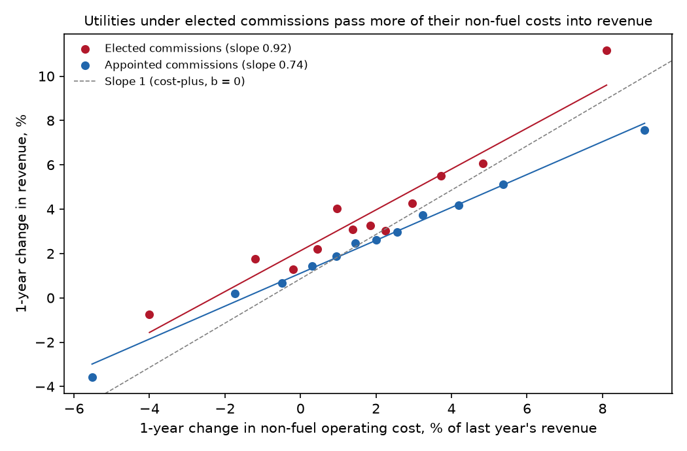
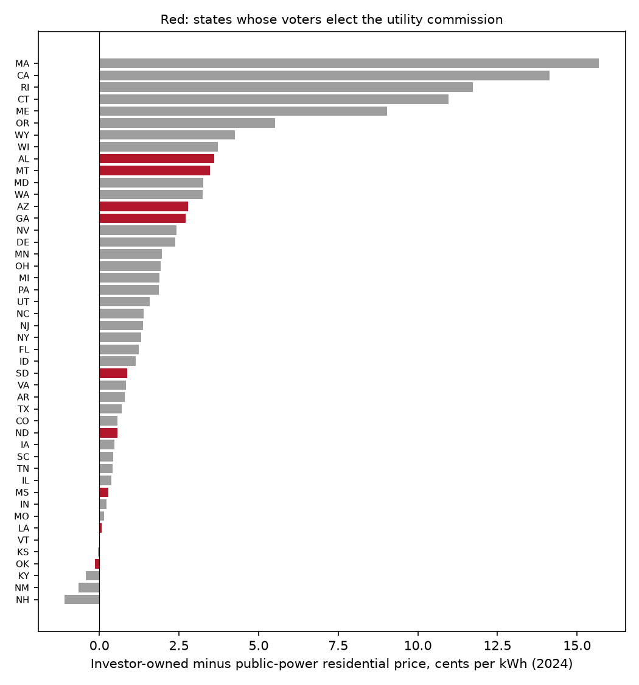

# Laffont & Tirole (1991) on modern data: findings

## In plain English

In 1991 Jean-Jacques Laffont and Jean Tirole showed that when a regulated company can buy influence with its
regulator, the best response is to give the company weaker incentives, so that a captured regulator has less to
give away. This repository measures how weak the incentives in American electric regulation are, using FERC Form 1
filings for 2005–2025, and whether they are weaker where voters elect the utility commission.

- **Regulation is close to cost-plus.** Across 115 investor-owned utilities, about 92 cents of every extra dollar of
  fuel and purchased power reaches revenue within a year and 97 cents within three. For all other operating costs
  the figures are 77 and 82 cents, so shareholders bear roughly a fifth of the costs the company controls.
- **Utilities under elected commissions pass through more.** At Georgia Power, Alabama Power, Arizona Public Service,
  Oklahoma Gas and Electric and the Entergy utilities in Louisiana and Mississippi, non-fuel pass-through is 0.92 in
  one year against 0.74 under appointed commissions. The difference is significant at one year (p = 0.033) and
  points the same way, without significance, in every other version.
- **They do not earn more on their plant.** Pre-tax returns on net plant average 7.08% under elected commissions
  and 7.32% under appointed ones, a difference that is not significant.
- **Elected commissions do not raise household prices.** Compared with municipal and cooperative utilities in the
  same state, investor-owned utilities charge households 3.11 cents per kWh more in appointed states and about 2 cents
  less of a premium in elected states (p = 0.013), though the gap is not significant when utilities are weighted by
  sales. That leans toward Besley and Coate (2003) and away from a simple capture story.

A friendlier tour is in the [README](../README.md). The rest of this page is the technical detail.

**Key to the labels below.** *gF*, *gN*, *gK* = change in fuel and purchased power, non-fuel operating cost and net
electric plant, each divided by revenue at the start of the change. *coef* on gF or gN = pass-through
$`\gamma`$; *power_b* = $`1-\gamma`$, the share of the cost change borne by shareholders. *elected* = share of the
utility's 2024 retail customers in states with voter-elected commissions; *gN:elected* = the interaction
$`\delta_N`$. *owns generation* = utility-years in which fuel burned in the utility's own plants is at least 5% of
revenue. *1-year*, *3-year* = horizon of the change. *iou* = investor-owned utility; *iou:elected* = $`\delta`$ in
the price equation; prices and gaps are in cents per kWh. *ret*, *mean_return* = pre-tax operating income as a
percent of the previous year's net electric plant. Standard errors are clustered by the utility's main state unless
the spec says otherwise; *clusters* gives their number. Dollar figures in the worked example are billions.

## Summary

**Question (Laffont and Tirole's):** does the threat of regulatory capture lead to lower-powered incentive schemes
for the regulated firm?

**Answer for US electric utilities, 2005–2025:** regulation is low-powered everywhere ($`\hat b_N`$ between 0.18 and
0.24, $`\hat b_F`$ between 0.03 and 0.08). It is lower-powered still where commissioners are elected, by 0.12 to
0.17 in every specification, significant at the 5% level in the one-year pooled version and not in the others.
Returns on plant are no higher under elected commissions, and investor-owned residential prices relative to public
power are lower or no different. Laffont and Tirole's prediction fits this pattern if elected commissions are the
easier ones for a utility to reach; Besley and Coate's view that elected commissions are pro-consumer fits the
price result. Neither the pass-through nor the price result can be read as causal, because commission type is not
randomly assigned.

## Figures

*Figure 1. One-year changes, year effects, fuel and plant changes partialled out, twelve bins per group.*

*Figure 2. Sales-weighted residential price of investor-owned minus public-power utilities, 2024.*

## Every table

The pooled and interaction regressions (`passthrough_regressions.csv`), the separate group estimates
(`power_by_commission.csv`), the return comparison (`returns_by_commission.csv`, `returns_means.csv`), the sample
size by group in 2024 (`sample_2024.csv`), the Georgia Power worked example, the price regressions and state gaps
from the extension, and the largest utilities with their own estimates. `utility_panel.csv`, the full
utility-year panel, is not reproduced here.

### passthrough_regressions.csv

| spec | sample | term | coef | se | ci_lo | ci_hi | p | n | utilities | clusters | power_b |
|---|---|---|---|---|---|---|---|---|---|---|---|
| pooled, 1-year | all | gF | 0.916 | 0.029 | 0.859 | 0.974 | 0.000 | 1998 | 115 | 48 | 0.084 |
| pooled, 1-year | all | gN | 0.765 | 0.036 | 0.694 | 0.836 | 0.000 | 1998 | 115 | 48 | 0.235 |
| pooled, 1-year | all | gK | 0.046 | 0.008 | 0.030 | 0.062 | 0.000 | 1998 | 115 | 48 |  |
| elected interaction, 1-year | all | gF | 0.902 | 0.029 | 0.845 | 0.959 | 0.000 | 1998 | 115 | 48 | 0.098 |
| elected interaction, 1-year | all | gN | 0.743 | 0.037 | 0.670 | 0.816 | 0.000 | 1998 | 115 | 48 | 0.257 |
| elected interaction, 1-year | all | gF:elected | 0.065 | 0.057 | -0.045 | 0.176 | 0.247 | 1998 | 115 | 48 |  |
| elected interaction, 1-year | all | gN:elected | 0.166 | 0.078 | 0.013 | 0.318 | 0.033 | 1998 | 115 | 48 |  |
| elected interaction, 1-year | all | elected | 0.002 | 0.002 | -0.003 | 0.007 | 0.373 | 1998 | 115 | 48 |  |
| pooled, 1-year | owns generation | gF | 0.912 | 0.040 | 0.834 | 0.989 | 0.000 | 1246 | 78 | 36 | 0.088 |
| pooled, 1-year | owns generation | gN | 0.825 | 0.040 | 0.746 | 0.904 | 0.000 | 1246 | 78 | 36 | 0.175 |
| pooled, 1-year | owns generation | gK | 0.034 | 0.008 | 0.019 | 0.049 | 0.000 | 1246 | 78 | 36 |  |
| elected interaction, 1-year | owns generation | gF | 0.877 | 0.037 | 0.805 | 0.950 | 0.000 | 1246 | 78 | 36 | 0.123 |
| elected interaction, 1-year | owns generation | gN | 0.794 | 0.043 | 0.711 | 0.878 | 0.000 | 1246 | 78 | 36 | 0.206 |
| elected interaction, 1-year | owns generation | gF:elected | 0.094 | 0.059 | -0.021 | 0.210 | 0.110 | 1246 | 78 | 36 |  |
| elected interaction, 1-year | owns generation | gN:elected | 0.120 | 0.083 | -0.041 | 0.282 | 0.145 | 1246 | 78 | 36 |  |
| elected interaction, 1-year | owns generation | elected | 0.003 | 0.003 | -0.003 | 0.008 | 0.326 | 1246 | 78 | 36 |  |
| elected interaction, 1-year, clustered by utility | all | gF:elected | 0.065 | 0.046 | -0.025 | 0.156 | 0.155 | 1998 | 115 | 115 |  |
| elected interaction, 1-year, clustered by utility | all | gN:elected | 0.166 | 0.083 | 0.002 | 0.329 | 0.047 | 1998 | 115 | 115 |  |
| pooled, 3-year | all | gF | 0.975 | 0.022 | 0.932 | 1.018 | 0.000 | 1782 | 112 | 47 | 0.025 |
| pooled, 3-year | all | gN | 0.818 | 0.040 | 0.740 | 0.895 | 0.000 | 1782 | 112 | 47 | 0.182 |
| pooled, 3-year | all | gK | 0.058 | 0.007 | 0.045 | 0.071 | 0.000 | 1782 | 112 | 47 |  |
| elected interaction, 3-year | all | gF | 0.979 | 0.025 | 0.929 | 1.028 | 0.000 | 1782 | 112 | 47 | 0.021 |
| elected interaction, 3-year | all | gN | 0.808 | 0.043 | 0.724 | 0.891 | 0.000 | 1782 | 112 | 47 | 0.192 |
| elected interaction, 3-year | all | gF:elected | -0.028 | 0.031 | -0.090 | 0.033 | 0.366 | 1782 | 112 | 47 |  |
| elected interaction, 3-year | all | gN:elected | 0.126 | 0.086 | -0.044 | 0.295 | 0.146 | 1782 | 112 | 47 |  |
| elected interaction, 3-year | all | elected | -0.001 | 0.005 | -0.011 | 0.009 | 0.869 | 1782 | 112 | 47 |  |
| pooled, 3-year | owns generation | gF | 0.936 | 0.034 | 0.869 | 1.003 | 0.000 | 1124 | 76 | 35 | 0.064 |
| pooled, 3-year | owns generation | gN | 0.838 | 0.051 | 0.739 | 0.938 | 0.000 | 1124 | 76 | 35 | 0.162 |
| pooled, 3-year | owns generation | gK | 0.048 | 0.006 | 0.036 | 0.059 | 0.000 | 1124 | 76 | 35 |  |
| elected interaction, 3-year | owns generation | gF | 0.932 | 0.044 | 0.845 | 1.019 | 0.000 | 1124 | 76 | 35 | 0.068 |
| elected interaction, 3-year | owns generation | gN | 0.809 | 0.057 | 0.697 | 0.921 | 0.000 | 1124 | 76 | 35 | 0.191 |
| elected interaction, 3-year | owns generation | gF:elected | 0.004 | 0.042 | -0.079 | 0.087 | 0.932 | 1124 | 76 | 35 |  |
| elected interaction, 3-year | owns generation | gN:elected | 0.150 | 0.098 | -0.042 | 0.342 | 0.125 | 1124 | 76 | 35 |  |
| elected interaction, 3-year | owns generation | elected | -0.004 | 0.005 | -0.013 | 0.005 | 0.395 | 1124 | 76 | 35 |  |
| elected interaction, 3-year, clustered by utility | all | gF:elected | -0.028 | 0.044 | -0.115 | 0.058 | 0.519 | 1782 | 112 | 112 |  |
| elected interaction, 3-year, clustered by utility | all | gN:elected | 0.126 | 0.085 | -0.041 | 0.292 | 0.139 | 1782 | 112 | 112 |  |

### power_by_commission.csv

| spec | sample | term | coef | se | ci_lo | ci_hi | p | n | utilities | clusters | power_b |
|---|---|---|---|---|---|---|---|---|---|---|---|
| 1-year | elected (share >= 0.5) | gF | 0.955 | 0.085 | 0.789 | 1.121 | 0.000 | 313 | 19 | 10 | 0.045 |
| 1-year | elected (share >= 0.5) | gN | 0.921 | 0.074 | 0.776 | 1.067 | 0.000 | 313 | 19 | 10 | 0.079 |
| 1-year | appointed (share < 0.5) | gF | 0.902 | 0.029 | 0.845 | 0.960 | 0.000 | 1685 | 97 | 41 | 0.098 |
| 1-year | appointed (share < 0.5) | gN | 0.742 | 0.037 | 0.669 | 0.815 | 0.000 | 1685 | 97 | 41 | 0.258 |
| 3-year | elected (share >= 0.5) | gF | 0.928 | 0.017 | 0.894 | 0.962 | 0.000 | 284 | 19 | 10 | 0.072 |
| 3-year | elected (share >= 0.5) | gN | 1.019 | 0.065 | 0.893 | 1.146 | 0.000 | 284 | 19 | 10 | -0.019 |
| 3-year | appointed (share < 0.5) | gF | 0.981 | 0.026 | 0.931 | 1.031 | 0.000 | 1498 | 94 | 40 | 0.019 |
| 3-year | appointed (share < 0.5) | gN | 0.801 | 0.043 | 0.717 | 0.884 | 0.000 | 1498 | 94 | 40 | 0.199 |

### returns_by_commission.csv

| spec | sample | term | coef | se | ci_lo | ci_hi | p | n | utilities | clusters |
|---|---|---|---|---|---|---|---|---|---|---|
| no controls | 2015-2025 utility-years | elected | -0.320 | 0.405 | -1.113 | 0.474 | 0.430 | 1170 | 110 | 47 |
| owns-generation control | 2015-2025 utility-years | elected | -0.200 | 0.398 | -0.979 | 0.580 | 0.616 | 1170 | 110 | 47 |

### returns_means.csv

| g | mean_return | utility_years | utilities |
|---|---|---|---|
| appointed | 7.324 | 987 | 94 |
| elected | 7.078 | 183 | 17 |

### sample_2024.csv

| group | utilities | revenue_bn | owns_generation |
|---|---|---|---|
| appointed | 92 | 272.671 | 50 |
| elected | 16 | 43.086 | 15 |

### worked_example_georgia_power.csv

| year | rev | fuel_pp | nonfuel | net_plant |
|---|---|---|---|---|
| 2021 | 9.107 | 2.964 | 3.518 | 36.693 |
| 2022 | 11.440 | 4.771 | 3.715 | 38.419 |
| change | 2.332 | 1.807 | 0.196 | 1.726 |

### price_regressions.csv

| spec | term | coef | se | ci_lo | ci_hi | p | n | states |
|---|---|---|---|---|---|---|---|---|
| unweighted | iou | 3.108 | 0.786 | 1.567 | 4.648 | 0.000 | 1204 | 46 |
| unweighted | iou:elected | -2.035 | 0.817 | -3.636 | -0.435 | 0.013 | 1204 | 46 |
| weighted by residential MWh | iou | 2.464 | 1.020 | 0.464 | 4.464 | 0.016 | 1204 | 46 |
| weighted by residential MWh | iou:elected | -0.466 | 1.142 | -2.704 | 1.772 | 0.683 | 1204 | 46 |
| IOU price level only, weighted | elected | -2.888 | 1.430 | -5.692 | -0.085 | 0.043 | 163 | 46 |

### price_gap_summary.csv

| elected | states | mean_gap | median_gap | mean_iou_price | mean_public_price |
|---|---|---|---|---|---|
| 0 | 37 | 2.834 | 1.369 | 17.679 | 14.845 |
| 1 | 9 | 1.580 | 0.873 | 13.925 | 12.345 |

### state_price_gaps.csv

| State | public_price | iou_price | gap | elected | iou_mwh |
|---|---|---|---|---|---|
| NH | 23.833 | 22.748 | -1.085 | 0 | 2,499,974 |
| NM | 14.587 | 13.941 | -0.646 | 0 | 5,440,187 |
| KY | 13.024 | 12.603 | -0.421 | 0 | 13,485,445 |
| OK | 12.318 | 12.177 | -0.141 | 1 | 15,409,007 |
| KS | 13.963 | 13.922 | -0.040 | 0 | 9,607,946 |
| VT | 22.071 | 22.090 | 0.019 | 0 | 1,594,099 |
| LA | 11.684 | 11.747 | 0.063 | 1 | 22,773,288 |
| MO | 12.761 | 12.906 | 0.145 | 0 | 20,933,969 |
| IN | 14.611 | 14.842 | 0.231 | 0 | 23,081,877 |
| MS | 13.276 | 13.562 | 0.287 | 1 | 7,581,173 |
| IL | 14.737 | 15.107 | 0.370 | 0 | 26,451,214 |
| TN | 12.417 | 12.837 | 0.420 | 0 | 636,147 |
| SC | 13.936 | 14.378 | 0.442 | 0 | 17,667,874 |
| IA | 13.110 | 13.583 | 0.473 | 0 | 9,580,115 |
| ND | 11.199 | 11.766 | 0.567 | 1 | 2,055,130 |
| CO | 14.592 | 15.163 | 0.571 | 0 | 10,438,431 |
| TX | 12.631 | 13.333 | 0.702 | 0 | 13,837,784 |
| AR | 11.899 | 12.694 | 0.795 | 0 | 9,583,157 |
| VA | 13.750 | 14.586 | 0.836 | 0 | 34,918,411 |
| SD | 12.528 | 13.402 | 0.873 | 1 | 2,172,547 |
| ID | 10.635 | 11.771 | 1.136 | 0 | 7,933,686 |
| FL | 13.203 | 14.436 | 1.234 | 0 | 103,549,232 |
| NY | 23.171 | 24.478 | 1.307 | 0 | 34,835,974 |
| NJ | 17.835 | 19.204 | 1.369 | 0 | 26,806,976 |
| NC | 13.194 | 14.585 | 1.391 | 0 | 40,604,489 |
| UT | 10.938 | 12.521 | 1.583 | 0 | 8,613,735 |
| PA | 15.451 | 17.324 | 1.873 | 0 | 37,874,951 |
| MI | 17.698 | 19.578 | 1.880 | 0 | 29,343,139 |
| OH | 15.251 | 17.183 | 1.932 | 0 | 14,571,465 |
| MN | 14.602 | 16.572 | 1.971 | 0 | 10,167,011 |
| DE | 14.842 | 17.231 | 2.389 | 0 | 2,916,139 |
| NV | 12.734 | 15.165 | 2.430 | 0 | 13,261,616 |
| GA | 12.781 | 15.491 | 2.710 | 1 | 29,113,358 |
| AZ | 13.482 | 16.265 | 2.784 | 1 | 20,619,406 |
| WA | 10.559 | 13.801 | 3.242 | 0 | 15,745,699 |
| MD | 14.754 | 18.015 | 3.261 | 0 | 20,611,306 |
| MT | 10.667 | 14.148 | 3.481 | 1 | 2,979,386 |
| AL | 13.171 | 16.772 | 3.601 | 1 | 18,058,325 |
| WI | 14.133 | 17.862 | 3.729 | 0 | 17,302,948 |
| WY | 9.673 | 13.929 | 4.256 | 0 | 1,496,611 |
| OR | 10.824 | 16.334 | 5.510 | 0 | 13,714,487 |
| ME | 15.268 | 24.297 | 9.029 | 0 | 4,263,320 |
| CT | 18.568 | 29.540 | 10.972 | 0 | 8,947,038 |
| RI | 16.525 | 28.263 | 11.738 | 0 | 2,291,381 |
| CA | 20.990 | 35.134 | 14.144 | 0 | 32,780,430 |
| MA | 16.501 | 32.178 | 15.677 | 0 | 5,275,087 |

### elected_state_utilities.csv

| utility | State | price | mwh | customers | public_price_same_state |
|---|---|---|---|---|---|
| Georgia Power Co | GA | 15.491 | 29,113,358 | 2,452,488 | 12.781 |
| Alabama Power Co | AL | 16.772 | 18,058,325 | 1,332,911 | 13.171 |
| Arizona Public Service Co | AZ | 16.450 | 15,579,131 | 1,256,120 | 13.482 |
| Entergy Louisiana LLC | LA | 11.054 | 14,061,790 | 957,522 | 11.684 |
| Oklahoma Gas & Electric Co | OK | 11.782 | 9,067,611 | 710,123 | 12.318 |
| Public Service Co of Oklahoma | OK | 12.727 | 6,292,790 | 501,093 | 12.318 |
| Entergy Mississippi LLC | MS | 13.214 | 5,483,701 | 384,611 | 13.276 |
| Tucson Electric Power Co | AZ | 15.630 | 3,964,038 | 412,747 | 13.482 |
| Cleco Power LLC | LA | 12.331 | 3,677,934 | 251,927 | 11.684 |
| NorthWestern Energy LLC - (MT) | MT | 14.228 | 2,800,513 | 328,125 | 10.667 |
| Southwestern Electric Power Co | LA | 13.459 | 2,679,887 | 207,011 | 11.684 |
| Entergy New Orleans, LLC | LA | 13.030 | 2,353,677 | 188,178 | 11.684 |

### utility_names.csv

| utility | state | elected_share | revenue_2024_bn | fuel_share_2024 | nonfuel_passthrough | fuel_passthrough | avg_return_on_plant | changes |
|---|---|---|---|---|---|---|---|---|
| PACIFIC GAS AND ELECTRIC COMPANY | CA | 0.000 | 19.918 | 0.201 | 0.789 | 0.635 | 5.447 | 13 |
| Southern California Edison Company | CA | 0.000 | 18.517 | 0.288 | -0.245 | 0.909 | 5.329 | 17 |
| Florida Power & Light Company | FL | 0.000 | 16.863 | 0.193 | 0.648 | 0.925 | 9.868 | 17 |
| Georgia Power Company | GA | 1.000 | 11.065 | 0.276 | 1.647 | 0.843 | 8.813 | 18 |
| Consolidated Edison Company of New York, Inc. | NY | 0.000 | 10.773 | 0.224 | 1.181 | 0.965 | 7.723 | 18 |
| VIRGINIA ELECTRIC AND POWER COMPANY | VA | 0.000 | 9.881 | 0.242 | 0.229 | 0.788 | 7.506 | 17 |
| Duke Energy Carolinas, LLC | NC | 0.000 | 9.711 | 0.227 | 1.470 | 0.695 | 8.255 | 17 |
| Commonwealth Edison Company | IL | 0.000 | 8.164 | 0.169 | 1.145 | 0.758 | 6.363 | 14 |
| ALABAMA POWER COMPANY | AL | 1.000 | 7.385 | 0.234 | 0.887 | 1.085 | 8.995 | 18 |
| Duke Energy Progress, Inc. | NC | 0.000 | 6.936 | 0.305 | 0.632 | 0.972 | 7.604 | 18 |
| PacifiCorp | UT | 0.000 | 6.587 | 0.391 | -0.207 | 1.161 | 4.705 | 17 |
| Duke Energy Florida, Inc. | FL | 0.000 | 6.428 | 0.258 | 1.315 | 0.491 | 9.019 | 18 |
| DTE Electric Company | MI | 0.000 | 6.161 | 0.228 | 1.092 | 1.138 | 7.446 | 18 |
| Public Service Electric and Gas Company | NJ | 0.000 | 5.926 | 0.378 | 1.694 | 0.829 | 7.779 | 18 |
| Arizona Public Service Company | AZ | 1.000 | 5.143 | 0.348 | 1.194 | 1.008 | 6.359 | 18 |
| Consumers Energy Company | MI | 0.000 | 5.001 | 0.274 | 0.694 | 0.987 | 9.068 | 18 |
| San Diego Gas & Electric Company | CA | 0.000 | 4.905 | 0.220 | 1.075 | 1.104 | 8.057 | 18 |
| Northern States Power Company (Minnesota) | MN | 0.130 | 4.834 | 0.314 | 1.135 | 0.976 | 6.259 | 18 |
| Connecticut Light and Power Company, The | CT | 0.000 | 4.604 | 0.401 | 0.861 | 0.853 | 8.359 | 18 |
| Appalachian Power Company | VA | 0.000 | 4.061 | 0.345 | 1.087 | 0.977 | 6.407 | 18 |
| Public Service Company of Colorado | CO | 0.000 | 3.845 | 0.299 | 1.190 | 0.733 | 6.551 | 18 |
| UNION ELECTRIC COMPANY | MO | 0.000 | 3.829 | 0.242 | 0.773 | 1.552 | 6.137 | 18 |
| Ohio Power Company | OH | 0.000 | 3.826 | 0.224 | 1.227 | 1.071 | 9.843 | 14 |
| Niagara Mohawk Power Corporation | NY | 0.000 | 3.714 | 0.315 | 1.050 | 0.466 | 4.746 | 18 |
| NSTAR Electric Company | MA | 0.000 | 3.626 | 0.232 | 0.403 | 0.895 | 9.111 | 16 |
| Wisconsin Electric Power Company | WI | 0.000 | 3.561 | 0.311 | -0.145 | 0.643 | 6.906 | 18 |
| Portland General Electric Company | OR | 0.000 | 3.461 | 0.387 | 1.542 | 0.966 | 6.191 | 18 |
| Puget Sound Energy, Inc. | WA | 0.000 | 3.433 | 0.376 | 0.625 | 0.889 | 6.781 | 18 |
| Baltimore Gas and Electric Company | MD | 0.000 | 3.422 | 0.373 | 0.958 | 0.818 | 9.953 | 17 |
| PECO Energy Company | PA | 0.000 | 3.326 | 0.318 | 0.982 | 1.418 | 8.509 | 18 |
| Oklahoma Gas and Electric Company | OK | 0.920 | 3.136 | 0.316 | 1.311 | 1.069 | 5.908 | 16 |
| Potomac Electric Power Company | MD | 0.000 | 3.036 | 0.342 | 0.862 | 1.063 | 7.317 | 18 |
| Duke Energy Indiana, Inc. | IN | 0.000 | 3.026 | 0.325 | 0.688 | 1.086 | 7.648 | 18 |
| Nevada Power Company, d/b/a NV Energy | NV | 0.000 | 2.957 | 0.392 | 0.829 | 0.989 | 8.135 | 15 |
| Massachusetts Electric Company | MA | 0.000 | 2.827 | 0.214 | 0.594 | 0.892 | 4.462 | 18 |
| South Carolina Electric & Gas Company | SC | 0.000 | 2.650 | 0.284 | -0.210 | 0.842 | 9.316 | 14 |
| Tampa Electric Company | FL | 0.000 | 2.638 | 0.222 | 2.335 | 0.689 | 7.872 | 18 |
| Ameren Illinois Company | IL | 0.000 | 2.621 | 0.170 | 1.338 | 1.259 | 8.375 | 13 |
| MidAmerican Energy Company | IA | 0.010 | 2.583 | 0.149 | 1.188 | 1.276 | 3.458 | 14 |
